# 时迹 / ShiJi

一款手机应用使用时长统计的 Android APP。数据只保存在本机 SQLite 中，没有网络权限。

## 交付物

| 项目 | 值 |
| --- | --- |
| 已签名 APK | `E:\DSH\AppScribe\artifacts\ShiJi-1.0.3-release.apk` |
| 体积 | 786,998 字节（768.6 KB） |
| SHA-256 | `f6a48600344a53d7d85a72dc9415116f3eaa409a92b11bd1bbc201ba13dcad06` |
| 包名 | `com.shiji.tracker` |
| versionCode / versionName | `4` / `1.0.3` |
| minSdk / targetSdk | `26` (Android 8.0) / `35` (Android 15) |
| compileSdk | `36` |
| 构建类型 | `release`，自签名，APK Signature Scheme v2 + v3 |
| 已安装验证 | API 37 模拟器（Pixel_10_Pro_XL）覆盖安装 1.0.2 → 1.0.3；一年默认今年、年份切换、多年汇总、跨页签保持均通过 |

APK 旁同时保留了哈希文件：`artifacts/ShiJi-1.0.3-release.apk.sha256`。

## 1.0.3

- 30 天之后新增「一年」档，默认显示当前年份。
- 一年档下方列出所有有数据的年份，可切换到去年/前年；「多年」汇总全部年份的总和。
- 排行 / 时段为 日 / 7 天 / 30 天 / 一年；趋势为 7 天 / 30 天 / 一年。
- `versionCode 4`；覆盖安装保留原数据库。

## 1.0.2

- 使用历史改为永久保留：`day_pkg` / `day_hour` 只重写实际重新观测到的日期，不按 30 天窗口删除。
- 排行 / 时段 / 趋势增加「全部」档，完整历史用 SQL 聚合；日期范围显示实际首末数据日。
- 首次授权后一次性回溯最多 365 天 `UsageEvents`，之后只做增量同步；已入库历史不再受采集窗口影响。
- 导出 / 导入继续使用 schema 1，包含全部历史；1.0.1 备份可直接导入，1.0.2 备份在旧版中安全忽略不可展示的日期。
- versionCode 3；覆盖安装保留原数据库。

## 1.0.1

- 修复底部导航「今日」页签在切换到排行 / 时段 / 趋势后点击无效：点击守卫误用了构造参数（固定为初始页签 0），而不是当前选中字段。
- 修复排行 / 时段 / 趋势分段控件初始档位无法回选，原因相同。
- versionCode 2；数据库结构与导出 JSON 格式不变，可直接覆盖安装，原有数据保留。

## 界面

| 今日（浅色） | 今日（深色） | 排行 |
| --- | --- | --- |
| 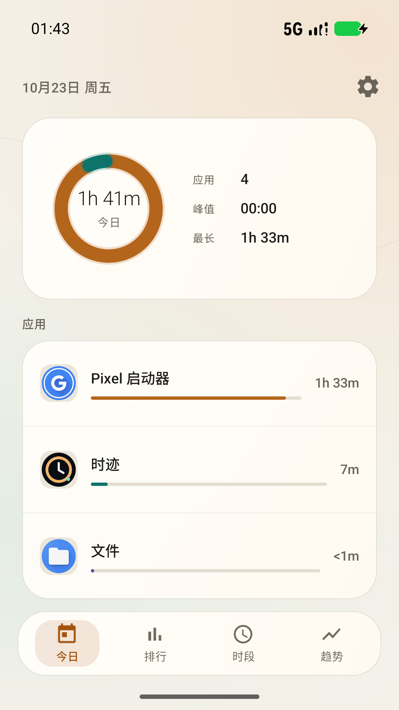 | 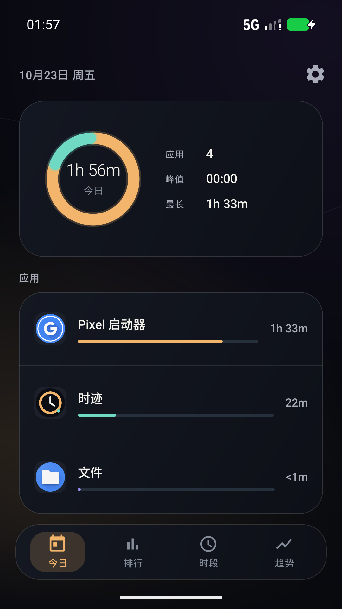 | 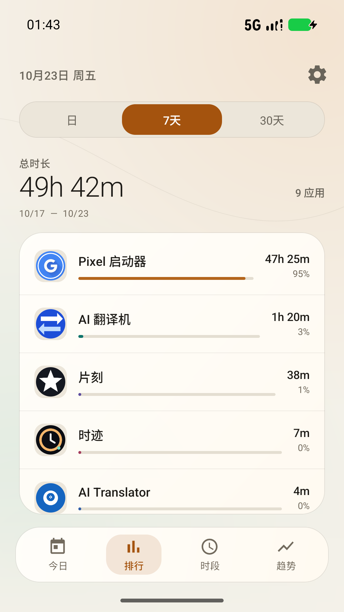 |

| 时段（7 天） | 趋势（30 天） | 权限引导 |
| --- | --- | --- |
| 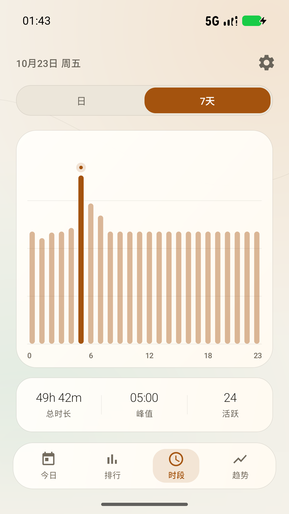 | 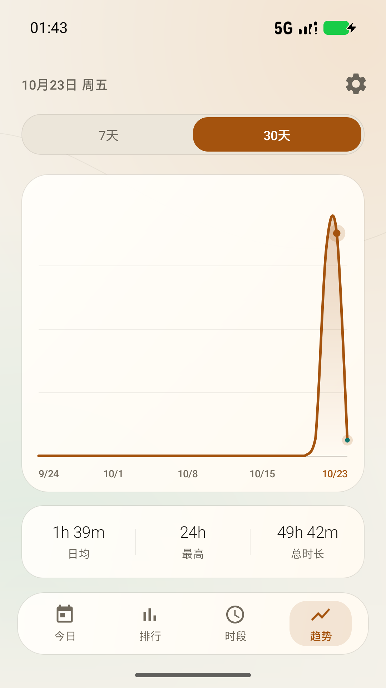 | 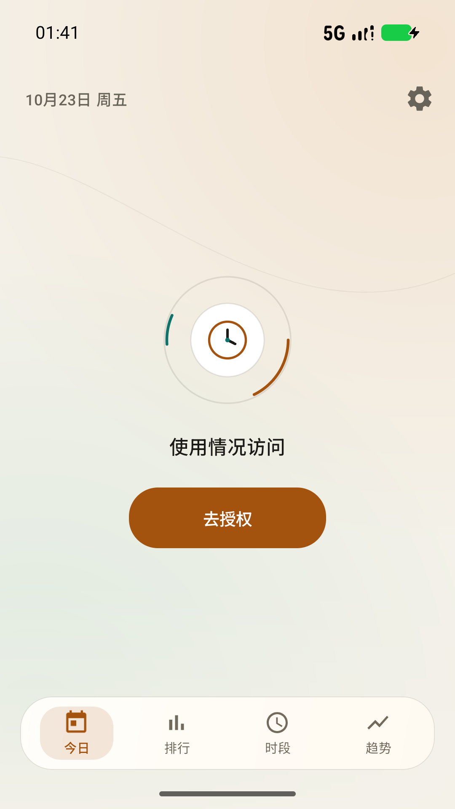 |

| 排行（一年） | 排行（多年） | 时段（一年） |
| --- | --- | --- |
| 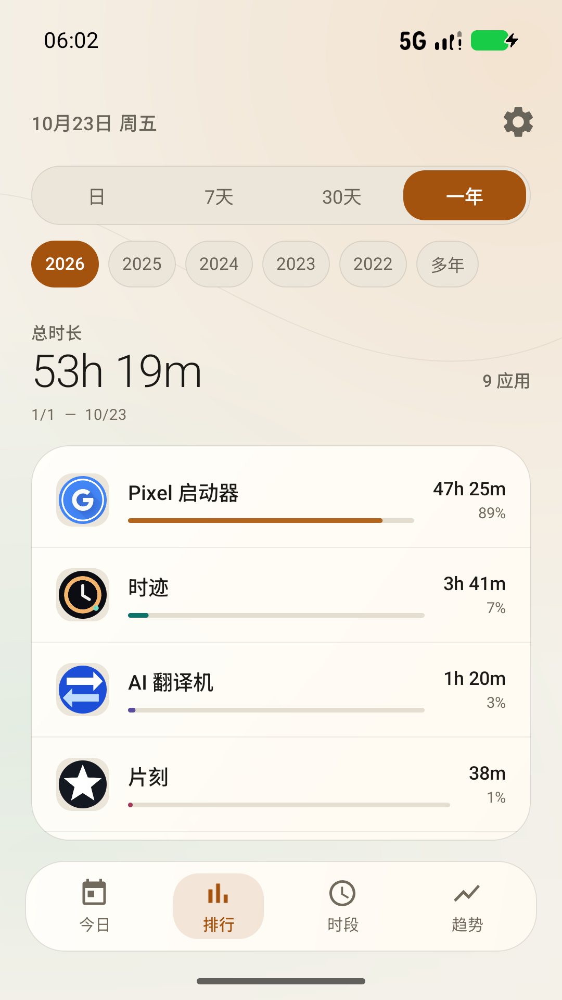 | 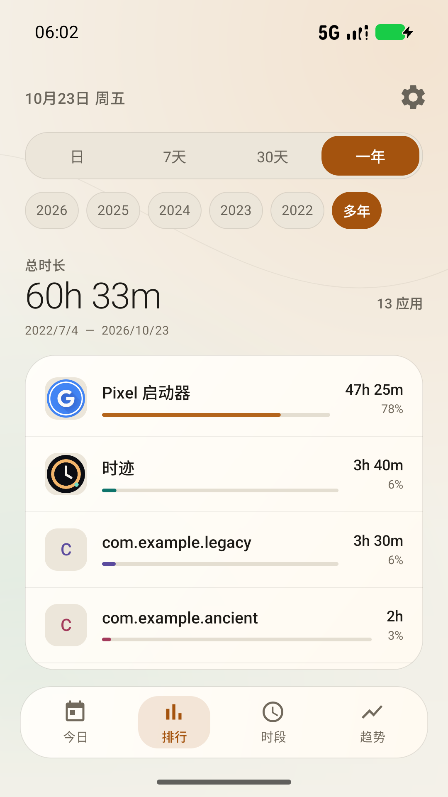 | 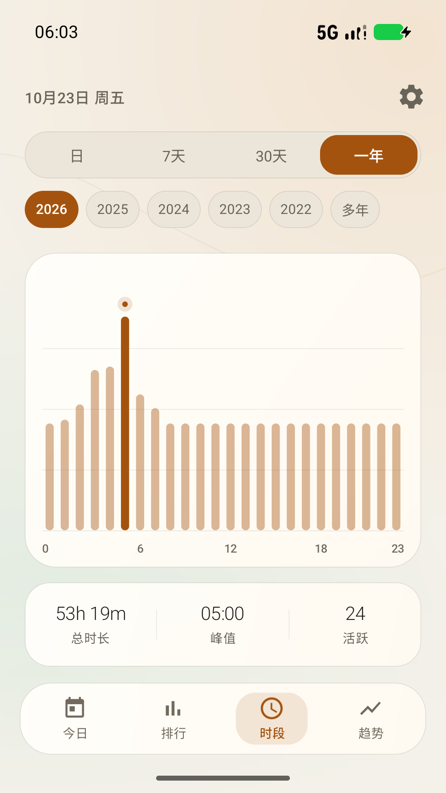 |

| 趋势（一年） | 趋势（多年） | 设置 |
| --- | --- | --- |
| 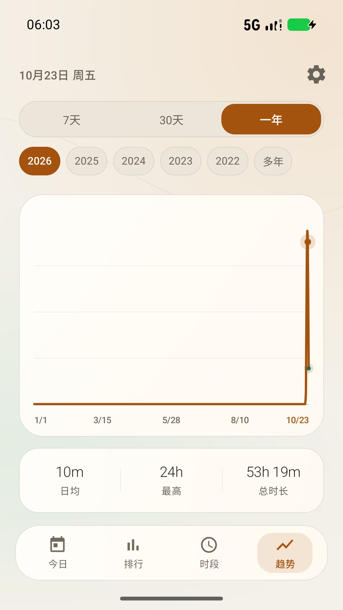 | 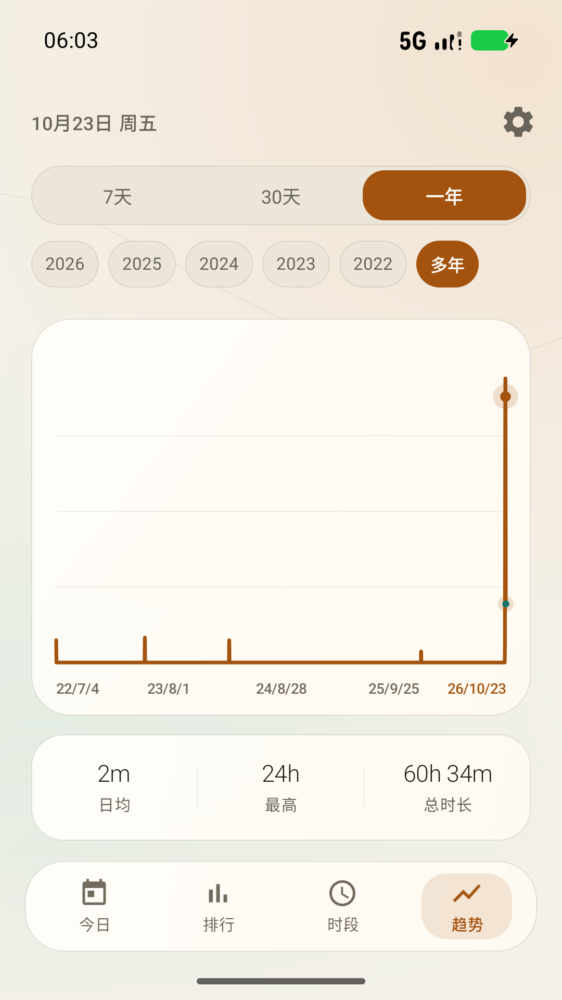 | 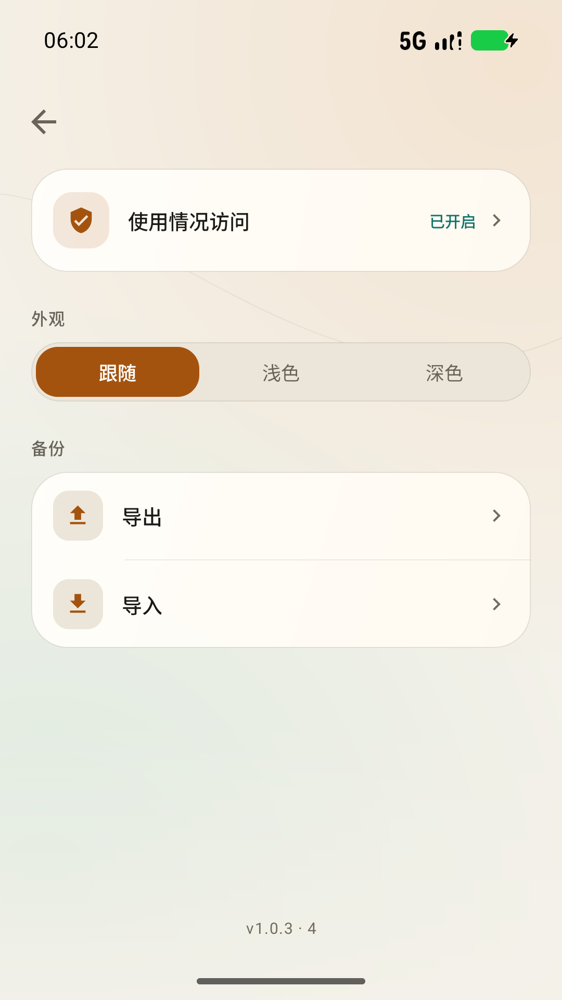 |

更多截图见 [`docs/screenshots`](docs/screenshots)。

## 功能

- 读取 `UsageStatsManager.queryEvents()`，将前台会话按本地日、应用、小时切分，统计全部有使用记录的应用。
- 历史永久保留：首次授权回溯最多 365 天，之后只增量重算最近几天；数据库不按展示窗口删除旧日期。
- 一年档默认当前年；有历史数据时列出可切换年份，并提供「多年」汇总全部年份。
- 展示形式：
  - 今日环形占比、总计/应用数/峰值/最长应用；
  - 应用排行（日 / 7 天 / 30 天 / 一年）；
  - 24 小时分布（日 / 7 天 / 30 天 / 一年，Canvas 自绘）；
  - 每日趋势（7 天 / 30 天 / 一年，Canvas 平滑折线 + 渐变面积）。
- 完全本地 SQLite：
  - `day_pkg(day, pkg, total_ms)`
  - `day_hour(day, hour, total_ms)`
  - `meta(last_sync_ms, history_synced)`
- SAF 导出/导入 JSON（`ACTION_CREATE_DOCUMENT` / `ACTION_OPEN_DOCUMENT`），无需存储权限。
- `allowBackup=false`，禁止系统云备份把数据库带出设备；也没有申请 `INTERNET` 权限。
- 浅色 / 深色 / 跟随系统三档主题，状态栏与导航栏图标同步切换。
- 无 AndroidX、无图表库、无网络库；全部为 Android framework + 自绘 View。

## 设计约束落实

- 界面只保留功能性标签、数值、日期和图标；没有副标题、引导长句、营销文案或关于页描述。
- 今日、排行页头部、时段、趋势、设置均为单屏布局，不依赖页面级滚动；排行中的内容列表独立滚动。
- 在 360 × 640 dp 与 448 × 997 dp 两种视口下验证过无溢出。
- 空状态、权限状态也只显示必要标识与操作按钮。

## 安装

### 方式一：复制 APK

把 `ShiJi-1.0.3-release.apk` 复制到手机，允许「安装未知应用」后打开安装。

### 方式二：adb

```powershell
C:\Users\Administrator\AppData\Local\Android\Sdk\platform-tools\adb.exe `
  install -r "E:\DSH\AppScribe\artifacts\ShiJi-1.0.3-release.apk"
```

### 首次打开

1. 首屏显示「使用情况访问」和「去授权」。
2. 点「去授权」，在系统页面找到 **时迹** 并开启使用情况访问。
3. 返回应用，数据自动同步并显示。
4. 若已关闭权限，应用不会清除历史数据，但不会继续采集。

手机里的系统路径通常是：设置 → 应用 → 特殊应用权限 → 使用情况访问 → 时迹。

## 使用

- 底部四个页签：今日 / 排行 / 时段 / 趋势。
- 右上角齿轮：权限状态、主题、导出、导入。
- 「排行」支持 日 / 7 天 / 30 天 / 一年；列表可滚动。
- 「时段」支持 日 / 7 天 / 30 天 / 一年；「趋势」支持 7 天 / 30 天 / 一年。
- 选「一年」后，下方年份条可切换今年/往年；「多年」为全部年份总和。默认显示当前年；若当前年无数据则显示最近有数据的年份。
- 应用回到前台或从系统授权页返回时自动刷新：首次回溯最多 365 天，之后只重算最近几天；旧日期不会被清理。

## 备份与迁移

- 导出：设置 → 导出 → 选择文件位置。导出的 JSON 包含当前数据库全部记录。
- 导入：设置 → 导入 → 选择 JSON。采用合并写入，同一天/应用或同一天/小时键会被导入值替换。
- 新手机迁移建议顺序：安装 → 授予使用情况访问 → 导入旧机 JSON。
- 若某一天在本机重新采集到使用事件，该天会以本机重新计算结果覆盖导入值；这一点适合“旧机历史 + 新机继续记录”的场景。

JSON 结构：

```json
{
  "format": "shiji-usage",
  "schema": 1,
  "version": "1.0.3",
  "exportedAt": "2026-10-23T01:38:06Z",
  "dayPkg": [{"day": "2026-10-23", "pkg": "com.example.app", "ms": 123456}],
  "hours": [{"day": "2026-10-23", "hour": 13, "ms": 654321}]
}
```

导入会校验格式、schema、日期、包名长度和时长范围。JSON 是明文，包含应用包名与使用时间元数据；请存放到可信位置。文件上限 32 MB。

## 本机构建环境

已检查并使用：

- JDK：`C:\Program Files\Android\Android Studio\jbr`（OpenJDK 25.0.3）
- Android SDK：`C:\Users\Administrator\AppData\Local\Android\Sdk`
- build-tools：`37.0.0`（aapt2 / d8 / zipalign / apksigner）
- platforms：`android-35`、`android-36`
- Gradle：`9.7.0`
- Android Gradle Plugin：`9.4.1`

Gradle 未加入 PATH，但本机已有可用的 Gradle 9.7.0；Gradle Wrapper 文件也已生成在仓库中。`gradlew` 第一次运行会联网下载 Gradle 9.7.0 发行包。由于本机没有把 java 放进 PATH，请优先使用 `build-gradle.ps1`（它会设置 `JAVA_HOME`）或先手工设置：

```powershell
$env:JAVA_HOME = "C:\Program Files\Android\Android Studio\jbr"
.\gradlew.bat deliverRelease
```

如果 Gradle 发行包下载过慢，可直接使用不依赖 Gradle 的 `build.ps1`。

## 构建

### 首选：Gradle

```powershell
cd E:\DSH\AppScribe
powershell -NoProfile -ExecutionPolicy Bypass -File .\build-gradle.ps1
```

该脚本自动查找 Android Studio 的 JDK、调用 `gradlew.bat deliverRelease`，然后执行 APK 校验。
`deliverRelease` 会先执行 `assembleRelease`，再复制到：

```text
E:\DSH\AppScribe\artifacts\ShiJi-1.0.3-release.apk
```

构建配置中的 `local.properties` 与 `gradle.properties` 写入了本机 SDK/JDK 路径；换机器时请调整：

- `local.properties` 的 `sdk.dir`
- `gradle.properties` 的 `org.gradle.java.home`

### 备用：不依赖 Gradle/AGP 的原生 SDK 流水线

```powershell
powershell -NoProfile -ExecutionPolicy Bypass -File .\build.ps1
```

该脚本使用 `aapt2 → javac → d8 → zipalign → apksigner`，自动探测 JDK/SDK，在离线环境也能构建，输出：

```text
artifacts\ShiJi-1.0.3-native.apk
```

原生流水线与 Gradle 构建使用同一份源码、同一个签名证书。

### 重新校验 APK

```powershell
powershell -NoProfile -ExecutionPolicy Bypass -File .\verify.ps1 `
  -Apk artifacts\ShiJi-1.0.3-release.apk
```

校验项包括 aapt2 badging、apkanalyzer manifest/permissions/summary、zipalign 4 字节对齐、apksigner v2/v3、`classes.dex`、`resources.arsc` 和禁止 INTERNET 权限。

## 签名信息

| 项目 | 值 |
| --- | --- |
| Keystore | `E:\DSH\AppScribe\keystore\shiji-release.p12` |
| 类型 | PKCS#12 |
| Alias | `shiji` |
| Store / key password | `ShiJi-Local-2026` |
| DN | `CN=ShiJi Release, OU=Personal, O=ShiJi, L=Local, ST=Local, C=CN` |
| 算法 | RSA 2048, SHA384withRSA |
| 有效期 | 10,000 天 |
| 证书 SHA-256 | `c306f74723b7ab362aae5e14813df3cbe820db0af45a9279a8cc25837f45ad10` |
| APK 签名 | v2=true, v3=true, v1=false（minSdk 26 不需要 v1） |

keystore 与密码一同保留是为了可复现构建和后续覆盖升级；它只是个人自签名证书，不应作为公开发布密钥。**丢失该 keystore 后将无法用同一签名覆盖安装新版本。**

## 校验结果

详细报告在 [`verify`](verify)：

- [`aapt2-badging.txt`](verify/aapt2-badging.txt)：包名、版本、minSdk 26、targetSdk 35、权限、启动 Activity。
- [`manifest-print.txt`](verify/manifest-print.txt) / [`apk-summary.txt`](verify/apk-summary.txt)：apkanalyzer 交叉校验。
- [`apk-permissions.txt`](verify/apk-permissions.txt)：只有 `PACKAGE_USAGE_STATS` 与 `QUERY_ALL_PACKAGES`，没有 `INTERNET`。
- [`apk-entries.txt`](verify/apk-entries.txt)：包含 `classes.dex`、`resources.arsc`。
- [`zipalign-check.txt`](verify/zipalign-check.txt)：4 字节对齐通过。
- [`apksigner-verify.txt`](verify/apksigner-verify.txt)：v2 + v3 签名有效，证书指纹见上表。
- [`device-smoke-test.txt`](verify/device-smoke-test.txt)：1.0.0 安装记录（保留作历史证据）。
- [`device-1.0.1/tab-fix.txt`](verify/device-1.0.1/tab-fix.txt)：1.0.1 覆盖安装、四页签往返、排行档位往返、设置返回记录；`today_101.png` 为修复后的今日页截图。
- [`device-1.0.2/all-history.txt`](verify/device-1.0.2/all-history.txt)：1.0.2 覆盖安装、全部档、2022 年历史导入、全量导出、重启持久化记录；同目录有 `rank-all.png`、`trend-all.png`、`hours-all.png` 和导出样本 `export-1.0.2-final.json`。
- [`device-1.0.2/fresh-backfill.txt`](verify/device-1.0.2/fresh-backfill.txt)：清除数据后首次授权的 365 天回溯记录（模拟器可用事件仅 4 天，回溯约 1.4 秒完成）。
- [`device-1.0.3/year-selection.txt`](verify/device-1.0.3/year-selection.txt)：1.0.3 一年档、默认今年、2025/2022 切换、多年汇总、跨页签保持记录；同目录有 6 张年度视图截图。

1.0.3 阶段在 API 37 模拟器验证了：覆盖安装保留数据；一年默认 2026；2026 为 53h19m / 9 应用，2025 为 1h，2022 为 2h，多年为 60h33m / 13 应用（2022/7/4–2026/10/23）；在排行选 2025 后切到时段/趋势的一年档仍保持 2025；冷启动回到默认 2026；crash buffer 为空。

1.0.2 阶段在 API 37 模拟器验证了：1.0.1 → 1.0.2 覆盖安装后原数据保留；导入 2022-07-04 的 2 小时记录后「全部」档从 55h37m / 12 应用变为 57h37m / 13 应用；导出 JSON 含 2022-07-04 起的全部 8 个数据日；强制停止重启后总量仍为 57h40m。

1.0.0 阶段验证了：权限引导页 → 系统使用情况访问页 → 返回后自动同步；浅色/深色；360 × 640 dp 紧凑视口；SAF 导出 JSON；导入测试 JSON 后 30 天排行出现 `2h` 的迁移数据。

## 已知限制

- 使用情况数据依赖系统 `UsageEvents`。部分厂商会裁剪历史事件，或对后台/分屏/息屏切换提供的事件不完整；时间可能与系统“数字健康”略有差异。
- 分屏时只按最后一个前台 Activity 统计；画中画、前台服务、多用户/工作资料不单独统计。
- 应用不运行后台常驻服务，只在打开或回到前台时刷新；不申请开机自启、无障碍或设备管理员权限。
- 数据库永久保留历史，但首次能回溯多少取决于系统 `UsageEvents` 的保留量；安装/授权之前更早的数据只能通过导入旧机 JSON 获得。
- 年份条只列出有数据的年份；「多年」汇总全部已存历史。当前年无数据时，一年档默认落到最近有数据的年份。
- 清除应用数据或卸载会删除本机数据库；迁移或换机前请先导出 JSON。
- “应用排行”会包含桌面启动器、设置等系统应用，只要是系统事件里出现的前台包。
- 导入是合并替换，不提供清空数据库的 UI；清空需在系统设置中清除时迹应用数据。
- JSON 明文，未加密。备份文件含有应用包名和时长。
- 横屏锁定为竖屏；超大系统字体缩放时，单屏固定布局可能截断部分标签。
- 仅使用自签名证书；`QUERY_ALL_PACKAGES` 与使用情况访问在部分应用商店有独立审核要求，本 APK 面向个人侧载。
- 已在 API 37 模拟器验证，未在 API 26 真机做矩阵测试；代码按 minSdk 26 编译并避开更高版本 API（有版本分支保护）。

## 目录

```text
app/src/main/java/com/shiji/tracker/
  MainActivity.java              单 Activity、导航、主题、SAF、后台调度
  data/UsageRepository.java      UsageEvents → 日/小时聚合；首次 365 天回溯 + 增量
  data/UsageDb.java              SQLite（day_pkg / day_hour / meta；全历史 SQL 聚合）
  data/BackupManager.java        JSON 导出/导入校验
  model/UsageModel.java          不可变页面数据模型
  ui/                            自绘图表、主题、应用列表与四个页面
app/src/main/res/                vector 图标、自适应启动图标、主题、字符串
gradlew / gradlew.bat / gradle/ Gradle Wrapper
build-gradle.ps1                自动设置 JDK 并调用 Gradle Wrapper
build.gradle / app/build.gradle AGP 9.4.1 release 签名配置
build.ps1                       无 Gradle 的 aapt2/d8/apksigner 备用流水线
verify.ps1                      APK 校验脚本
keystore/                       自签名 release keystore
artifacts/                      最终已签名 APK + SHA-256（旧版本在 archive/）
verify/                         构建报告 + device-1.0.1 / 1.0.2 / 1.0.3 证据
docs/screenshots/               实机截图
```

## 第三方

无运行时第三方库。界面图标路径取自 Google Material Icons（Apache License 2.0）并以内联 VectorDrawable 形式保存。Android、Gradle、AGP 属于各自的版权与许可方。

截图中的使用数据来自模拟器环境，仅用于展示界面。
